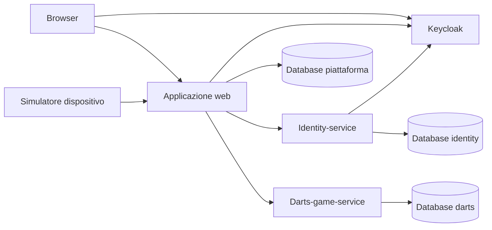

# Connected Games Platform

Connected Games Platform è una piattaforma web per amministrare partite e dispositivi di gioco connessi. Il gioco attualmente implementato è **Freccette 501**, gestito attraverso una console amministrativa e un simulatore di dispositivo.

Il progetto applica i concetti di **microservizi con API HTTP/JSON** e **autenticazione centralizzata con Keycloak**, separando la gestione della piattaforma dalle regole del gioco e dai profili degli utenti.

## Funzionalità

- Accesso alla console amministrativa tramite Keycloak.
- Creazione e gestione delle partite di freccette.
- Assegnazione dei giocatori tramite i profili dell'identity-service.
- Gestione dei dispositivi, abilitazione e associazione alle partite.
- Apertura, avvio e terminazione delle partite.
- Invio dei lanci e consultazione dello stato attraverso il simulatore C++.
- Gestione dei punteggi 501, dei turni, del bust e del checkout double-out.
- Consultazione dello stato e dei risultati delle partite nella console web.

## Architettura

La piattaforma comprende un'applicazione principale e due microservizi Yii2, eseguiti come processi separati. Keycloak è il server esterno dedicato all'autenticazione.

| Componente | Responsabilità | Dati di proprietà |
| --- | --- | --- |
| Applicazione principale | Interfaccia amministrativa, gestione generale delle partite, partecipanti e dispositivi; API del simulatore e coordinamento del servizio di gioco | Catalogo giochi, partite amministrative, partecipazioni e dispositivi |
| [Identity-service](services/identity-service/README.md) | Profili, ruoli applicativi, associazione delle identità Keycloak e verifica degli access token tramite introspezione | Profili locali e collegamenti alle identità Keycloak |
| [Darts-game-service](services/darts-game-service/README.md) | Regole delle freccette, registrazione dei tiri, turni, punteggi ed esito sportivo | Stato di gioco, giocatori della partita e tiri |
| [Keycloak](docs/KEYCLOAK.md) | Autenticazione degli utenti, emissione e gestione dei token | Account e credenziali Keycloak |

Le tre applicazioni PHP hanno configurazioni e connessioni database distinte. I due microservizi dispongono di entry point, dipendenze Composer e migrazioni propri. Il codice è organizzato in un unico repository.

## Comunicazione tra componenti



Il simulatore comunica con l'API dell'applicazione principale. Questa identifica il dispositivo e la partita e inoltra le operazioni al darts-game-service. Il servizio applica le regole e restituisce l'esito tramite HTTP; l'applicazione principale coordina il ciclo amministrativo della partita e ne presenta lo stato.

Le API interne utilizzano JSON e credenziali dedicate. L'integrazione con il gioco prevede chiavi di idempotenza per riconoscere richieste ripetute e identificativi di correlazione per seguire le chiamate. Le credenziali dei dispositivi e dei servizi sono distinte dai token degli utenti web.

## Autenticazione e profili

Il login utilizza **Authorization Code con PKCE S256** e gli endpoint OpenID Connect di Keycloak. L'applicazione conserva i token nella sessione PHP e gestisce rinnovo e logout.

L'identity-service verifica gli access token mediante introspezione autenticata, controllandone validità, emittente, audience e scadenza. L'identità Keycloak viene collegata esplicitamente a un profilo locale tramite subject ed issuer, mantenendo stabile l'identificativo applicativo del giocatore.

I ruoli applicativi `admin` e `player` sono conservati nell'identity-service. La console è riservata agli amministratori; Keycloak gestisce le credenziali, mentre i controlli sui profili e sulle operazioni restano nella piattaforma.

## Tecnologie

| Ambito | Tecnologie |
| --- | --- |
| Backend web e servizi | PHP 8.2+, Yii2, Composer |
| Persistenza applicativa | MySQL, ActiveRecord e migrazioni Yii |
| Interfaccia web | Bootstrap 5 |
| Comunicazione | API HTTP/JSON |
| Autenticazione | Keycloak, Authorization Code con PKCE, introspezione token |
| Simulatore | C++ per Windows |
| Sviluppo locale | PhpStorm e MySQL tramite XAMPP; Keycloak avviabile direttamente su Windows |

## Organizzazione del repository

```text
config/                         Configurazione dell'applicazione principale
commands/                       Comandi console, inclusa la creazione dei database
controllers/                    Console web e API del dispositivo
models/                         Modelli della piattaforma
views/                          Pagine della console
services/                       Client HTTP e integrazioni dell'app principale
  identity-service/             Microservizio dei profili e verifica token
  darts-game-service/           Microservizio del gioco freccette
device-simulator-cli/           Simulatore C++ dei dispositivi
database/                       Files utilizzati per la creazione del database
migrations/                     Migrazioni dell'applicazione principale
tests/                          Suite di test presenti nel progetto
```

## Installazione e avvio

Per requisiti, database, configurazioni PhpStorm, avvio senza Docker, configurazione Keycloak e risoluzione degli errori, seguire la guida [INSTALLAZIONE COMPLETA](<INSTALLAZIONE COMPLETA.md>).

La configurazione locale descritta usa le porte `8080` per la console, `8001` per identity-service, `8003` per darts-game-service e `8081` per Keycloak.

## Ambito didattico

Il progetto si concentra sulla separazione delle responsabilità in servizi, sulla collaborazione tramite API e sull'integrazione con Keycloak. MQTT, Mosquitto, Arduino e un'architettura a eventi non fanno parte del flusso attualmente implementato.
